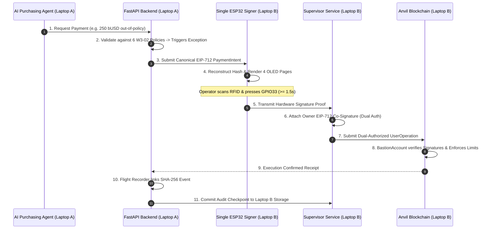
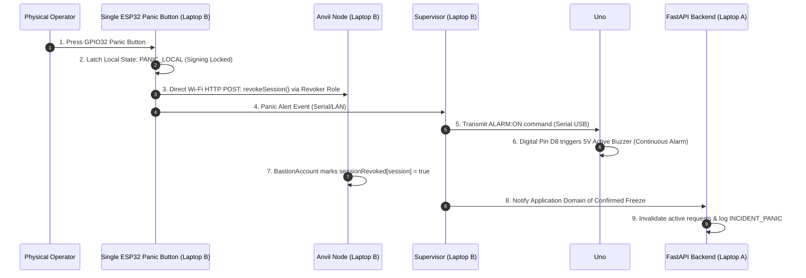

# Two-Laptop Integration & Network Architecture Specification — v2.3

This document defines the complete distributed communication topology, network port ownership, security boundaries, and cross-machine verification procedures for BASTION X.

---

## 1. Network Topology & Port Ownership Table

| Host Node | Service Component | Network Port | Protocol | Owning Machine | Permitted Callers |
|---|---|---|---|---|---|
| **Laptop A** | React 18 Web Console | `5173` | HTTP / WS | Laptop A (RTX 5060) | Operator Browsers (LAN) |
| **Laptop A** | FastAPI Application API | `8000` | HTTP / REST | Laptop A (RTX 5060) | React Frontend, AI Agent |
| **Laptop B** | Local Anvil Blockchain | `8545` | JSON-RPC (HTTP) | Laptop B (Intel Ultra 7) | Laptop A API, ESP32 Signer, Bundler |
| **Laptop B** | ERC-4337 Bundler | `3000` | HTTP / RPC | Laptop B (Intel Ultra 7) | Laptop A API |
| **Laptop B** | Supervisor API | `8010` | HTTP / REST | Laptop B (Intel Ultra 7) | Laptop A API, UNO Q Edge Node |
| **Laptop B** | UNO Q Edge Coordinator | Internal | Socket / HTTP | Arduino UNO Q 4GB | Laptop B Supervisor |
| **Laptop C** | Standby Anvil Mirror | `8545` | JSON-RPC | Laptop C (RTX 4060) | Failover only |

> [!NOTE]
> **v2.3 Evolution:** Port 80 ESP8266 Alert Listener is DECOMMISSIONED. The 5V active buzzer is driven directly over USB serial by Arduino Uno #1 Pin D8 on Laptop B.

---

## 2. Distributed Lifecycle: End-to-End Payment Intent Flow



---

## 3. Distributed Emergency Revocation Flow



> [!WARNING]
> **Security Implication:** The alarm now depends on the Intel supervisor/Uno #1 serial path and no longer provides independent wireless notification.

---

## 4. Cross-Laptop Network Pre-Flight Checklist
Run these checks before beginning the demonstration:
1. **Network Connectivity:**
   ```powershell
   # From Laptop A:
   ping <LAPTOP_B_IP>
   curl http://<LAPTOP_B_IP>:8545 # Should respond with Anvil JSON-RPC
   curl http://<LAPTOP_B_IP>:8010/supervisor/health
   ```
2. **Uno #1 Buzzer Test:**
   ```powershell
   # From Laptop B (Supervisor API):
   curl -X POST http://localhost:8010/supervisor/alarm -H "Content-Type: application/json" -d '{\"active\":true, \"reason\":\"TEST\"}'
   # Verify buzzer sounds on Uno #1 Pin D8!
   ```
3. **Run Integrated Cross-Check:**
   ```powershell
   .\scripts\check_integration.ps1 -LaptopBIp <LAPTOP_B_IP>
   ```
